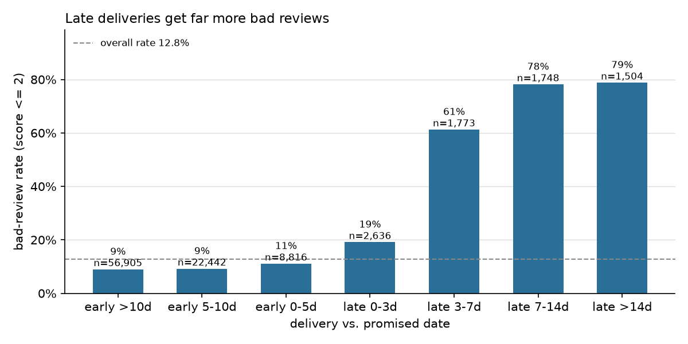

# Olist Order Risk

Predict whether a delivered order will get a bad review (score 1-2), so support can contact the customer first.

Data: [Olist Brazilian E-commerce](https://www.kaggle.com/datasets/olistbr/brazilian-ecommerce) from Kaggle. Tools: DuckDB, pandas, scikit-learn, FastAPI.

## Idea

Orders that arrive late, take long to ship or have high freight cost probably get more bad reviews. I tested this and built a model that scores each order when it is delivered.

- Target: `bad_review = 1` if `review_score <= 2` (12.8% of 95,824 orders).
- Features are built in SQL ([sql/features.sql](sql/features.sql)): delay, shipping time, freight ratio, number of items, payment, the seller's earlier bad-review rate, the customer's earlier orders.
- The seller feature uses only reviews written before the order was delivered, so it does not leak the future.

## What I found



- Delay matters a lot: 3+ days late gives 61-79% bad reviews, early orders about 9-11%.
- Long shipping time matters only for the slowest 10% of orders.
- Freight cost does not matter (12-14% in every group).

## Model

I trained on older orders (until 2018-05-27) and tested on newer ones, because the model has to predict the future in real use.

| Model | ROC-AUC | PR-AUC |
|---|---|---|
| Rule: "is late" | 0.571 | 0.139 |
| Logistic regression | 0.700 | 0.253 |
| Gradient boosting | 0.715 | 0.316 |

I flag an order if its score is above 0.227. That threshold was picked on validation data so that at least half of the flagged orders are really bad. On the test set it flags 8.3% of orders, with precision 0.38 and recall 0.33.

## Limits

- The model is only moderately accurate. Many bad reviews have reasons that are not in the data.
- Precision was 0.5 on validation but 0.38 on test, because the bad-review rate dropped from 13.6% to 9.7%.
- It scores at delivery time, so it cannot warn earlier.
- I did not tune the hyperparameters.

## Run it

```bash
python -m venv .venv
.venv\Scripts\Activate.ps1
pip install -r requirements.txt
```

Put the Kaggle CSV files into `data/raw/`, then:

```bash
python -m src.load_data
python -m src.build_features
python -m src.eda
python -m src.train
pytest
uvicorn src.api:app --reload
```

The API is at http://127.0.0.1:8000/docs. Send an order's features to `POST /score` and get back a risk score and a flag.
